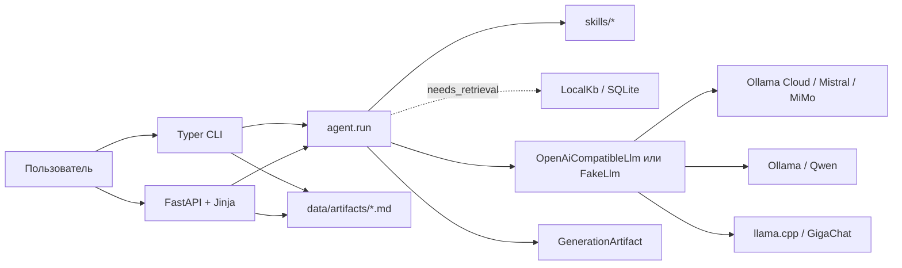

# Архитектура Misterio

Misterio — локальное Python-приложение для запуска текстовых навыков через
OpenAI-compatible LLM. Проект состоит из одного пакета `misterio`; CLI и web UI
используют общий синхронный конвейер генерации.



## Компоненты

- `src/misterio/contracts.py` — Pydantic-контракты задания, манифеста навыка,
  запроса к LLM, результата и фрагмента базы знаний.
- `src/misterio/skills.py` — поиск папок навыков, загрузка и валидация
  `manifest.json`.
- `src/misterio/agent.py` — общий конвейер одного задания.
- `src/misterio/llm.py` — протокол LLM, детерминированный `FakeLlm` и HTTP-клиент
  OpenAI-compatible `/chat/completions`.
- `src/misterio/kb.py` — локальная SQLite-база и простой поиск по пересечению
  нормализованных слов.
- `src/misterio/cli.py` — команды Typer для списка навыков, генерации и загрузки
  seed-файлов в KB.
- `src/misterio/api.py` и `templates/index.html` — синхронный локальный web UI.
- `src/misterio/models.py` — allowlist облачных и локальных модельных профилей,
  сборка LLM-клиента и переключение Docker-сервисов для локальных моделей.
- `mist` — Git Bash-команды запуска, проверок и переключения LLM backend.

## Поток генерации

1. CLI или UI создаёт `Job` с текстом задачи и идентификатором навыка.
2. `agent.run` загружает манифест и `SKILL.md`, записывает версию навыка в
   задание.
3. Если `needs_retrieval=true`, агент запрашивает до пяти фрагментов через
   переданный объект `Knowledge`. Без такого объекта выполнение завершается
   ошибкой.
4. Агент добавляет найденные фрагменты с `source` и `locator` в prompt после
   `SKILL.md` и пользовательского brief.
5. Два кандидата генерируются последовательно, чтобы локальные GPU backends не
   конкурировали за KV-cache. Агент выбирает их локально по формальным ошибкам и
   рифме; один repair-вызов выполняется, только если оба кандидата невалидны.
6. `GenerationArtifact` содержит итог, источники и диагностику выбора кандидата.
   CLI и UI сохраняют итог в `<uuid>.md`, а полный артефакт — в `<uuid>.json`.

Текущий навык `skills/chastushki` имеет `needs_retrieval=false`, поэтому KB в
генерации частушек не участвует.

## Навыки

Каждый навык — папка в `skills/` с двумя обязательными файлами:

- `manifest.json` задаёт id, версию, схемы входа/выхода, температуру и
  необходимость retrieval;
- `SKILL.md` содержит инструкции, которые целиком включаются в prompt.

Ядро не содержит ветвлений по имени навыка. Новый навык становится доступен
после добавления корректной папки и манифеста.

## LLM backends

`Settings` читает из `.env` только `MISTERIO_LLM_API_KEY`. URL, API-стиль и
точный model ID задаются фиксированным allowlist в `models.py`. Реестр содержит
четыре профиля:

- `mistral` — Ollama Cloud с `mistral-large-3:675b`, профиль по умолчанию;
- `mimo` — Ollama Cloud с `mimo-v2.6-flash`, ручной экономичный fallback;
- `qwen` — Ollama на `127.0.0.1:11434` с моделью `qwen3:8b`;
- `gigachat` — CUDA-образ `llama.cpp` на `127.0.0.1:8080` с
  `GigaChat3.1-10B-A1.8B-GGUF:Q4_K_M`.

`./mist pull qwen`, `./mist pull giga` и `./mist pull all` скачивают веса через
одноразовые pull-сервисы, не запуская LLM backends. `./mist qwen` и
`./mist giga` вручную подготавливают соответствующий локальный сервис. Выбор
локального профиля в UI сначала останавливает оба сервиса, затем запускает
выбранный. `gigachat-pull` сохраняет GGUF в model volume, а GigaChat-сервер
открывает его по явному локальному пути без сетевой загрузки. Облачные профили
переключаются только в памяти процесса и не вызывают Docker; после перезапуска
активен `mistral`. Автоматического fallback нет. UI принимает только ключи из
фиксированного allowlist; переключение защищено same-origin проверкой и
process-wide lock. API-ключ передаётся только облачным endpoint.

## Локальная база знаний

`misterio kb ingest` читает `.md` и `.txt` из `kb/seed/`, полностью пересоздаёт
таблицу `chunks` в `data/kb.sqlite3` и сохраняет каждый файл одним фрагментом.
Поиск выполняется в памяти после чтения всех строк SQLite и ранжирует документы
по доле слов запроса, найденных в тексте. Это локальная минимальная реализация,
не векторный поиск.

## Интерфейсы и данные

- `misterio skills ls` выводит доступные навыки.
- `misterio run <brief> --skill <id> [--model <profile>]` запускает реальную LLM;
  `--fake` использует `FakeLlm` без сети.
- `uvicorn misterio.api:app` поднимает форму выбора модели, навыка и ввода
  задачи.
- `data/` содержит runtime-данные и не предназначен для Git; Docker-модели
  хранятся в именованных volumes `ollama` и `huggingface`.

UI и CLI выполняют генерацию синхронно. Очереди заданий, worker-процесс,
аутентификация и удалённая KB в проекте отсутствуют.

## Проверки

Тесты в `tests/` покрывают контракты, реестр навыков, агентский конвейер, LLM
адаптер с mock HTTP, CLI, UI и локальную KB. `tests/test_evals.py` — контрактная
проверка фиксированных данных через `FakeLlm`. Настоящая оценка настроенной модели
помечена `model_eval`, запускается явно и сохраняет агрегированный JSON-отчёт с
результатами, диагностикой и временем в `data/evals/`:

```bash
MISTERIO_RUN_MODEL_EVALS=1 uv run pytest -m model_eval --model-profile=mistral
MISTERIO_RUN_MODEL_EVALS=1 uv run pytest -m model_eval --model-profile=mimo
```

Основные команды: `./mist test` и `./mist lint`.

## Границы проекта

- LLM считается внешним сервисом и доступна только через адаптер.
- Навыки декларативны и не импортируют Python-код в ядро.
- Retrieval включается только манифестом навыка.
- Runtime-данные отделены от исходников каталогом `data/`.
- Docker-порты LLM привязаны к localhost; одновременно предполагается работа
  только одного backend.
